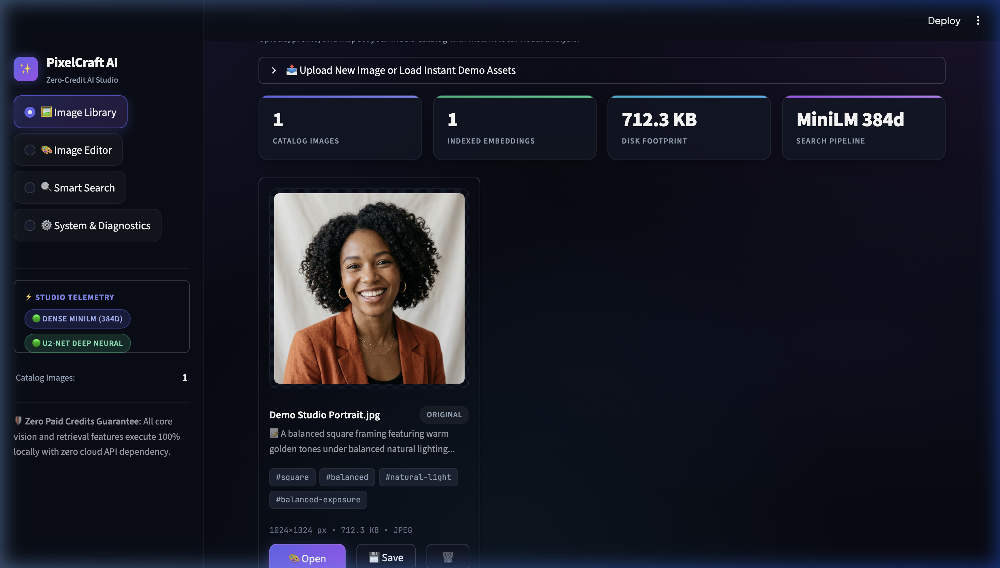
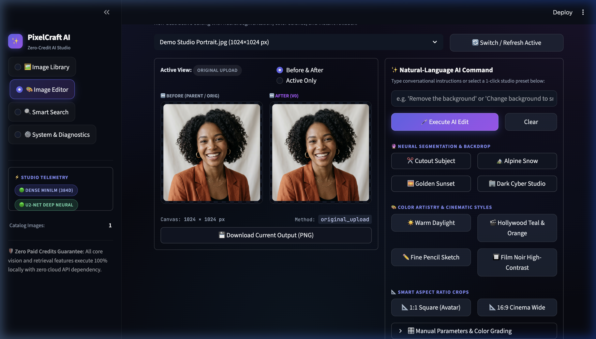
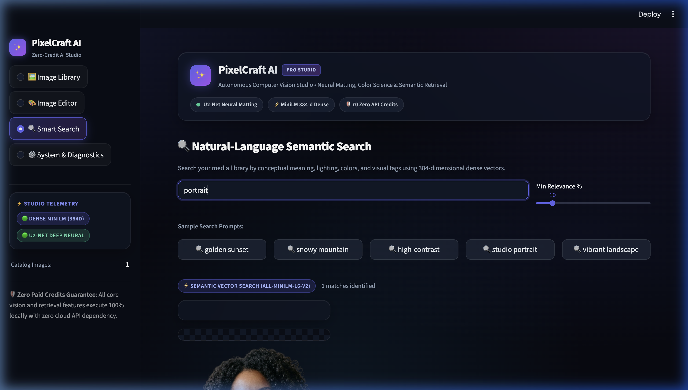
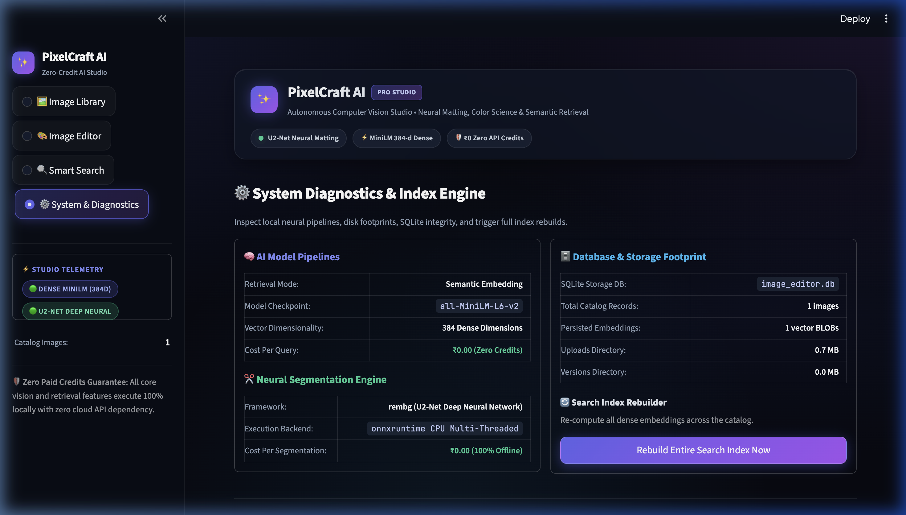

<div align="center">

# ✨ PixelCraft AI — Intelligent Image Studio

### *Autonomous Local AI Image Editing, Neural Matting & Semantic Retrieval Platform*

[](https://www.python.org/)
[](https://streamlit.io/)
[]()
[]()
[]()
[]()

<br>

<p align="center">
  <b>PixelCraft AI</b> is a production-grade, portfolio-ready computer vision studio and natural-language asset management platform. Built from the ground up to deliver high-precision image transformations, semantic vector retrieval, and non-destructive version branching—<b>running 100% locally with ₹0 budget and zero paid external API credits</b>.
</p>

[Key Features](#-key-features) • [UI Showcase](#-visual-interface-showcase) • [Architecture](#-system-architecture) • [Quick Start](#-quick-start) • [Workflows](#-core-workflows--capabilities) • [Testing](#-automated-testing-suite) • [Deployment](#-deployment)

</div>

---

## 📸 Visual Interface Showcase

PixelCraft AI features a custom dark glassmorphic design system with ambient mesh lighting, responsive cards, live hardware telemetry badges, and interactive controls.

### 1. 🖼️ Image Library & Catalog
Upload, organize, and profile images with instant heuristic visual analysis, metadata badges, and 1-click instant demo presets.
<div align="center">
  
</div>

<br>

### 2. 🎨 AI Studio & Side-by-Side Comparison
Execute conversational commands (e.g. *"Remove background"*, *"Change background to snowy mountain"*, *"Apply cinematic teal and orange"*) with real-time before/after previews on a studio transparency checkerboard.
<div align="center">
  
</div>

<br>

### 3. 🔍 Natural-Language Semantic Search
Find images across your media catalog by conceptual meaning, lighting, colors, and subject matter using 384-dimensional dense vectors.
<div align="center">
  
</div>

<br>

### 4. ⚙️ System Diagnostics & Model Telemetry
Monitor live AI model pipelines, ONNX multi-threaded CPU execution, SQLite storage footprint, and run full vector index rebuilds.
<div align="center">
  
</div>

---

## 🌟 Key Features

- **🪄 Conversational Natural-Language Editing**:
  - Natural-language command parser mapping user intent to deterministic and neural image operations.
  - Quick 1-click studio presets across **Neural Segmentation & Backdrop**, **Color Artistry & Cinematic Styles**, and **Smart Aspect Ratio Crops**.
- **✂️ Local Neural Background Matting (U2-Net)**:
  - High-precision subject cutout using local deep learning neural networks via `rembg` & `onnxruntime`.
  - Zero external cloud latency, runs 100% offline with zero per-image API billing.
- **🏔️ Realistic Procedural Backdrop Compositing**:
  - Automatically composite isolated subjects onto alpine snowy peaks, golden sunset skies, dark cyberpunk studios, or solid studio colors.
- **📜 Non-Destructive Version Branching**:
  - Original uploaded files remain **strictly immutable** on disk.
  - Every edit generates an incremental child version with parent lineage, applied parameters, and rollback support.
- **🔍 384-Dimensional Dense Semantic Search**:
  - Neural text and caption embeddings computed via `sentence-transformers/all-MiniLM-L6-v2`.
  - Fast cosine similarity ranking computed via normalized matrix dot products in NumPy.
  - Automatic, zero-dependency **Scikit-learn TF-IDF fallback** for restricted or low-memory environments.
- **📸 1-Click Instant Demo Presets**:
  - Built-in high-resolution portrait and landscape demo assets allow immediate experimentation without requiring local file uploads.
- **🗄️ ACID SQLite Storage Engine**:
  - Relational schema with foreign keys, cascading deletions, and BLOB vector serialization.

---

## 🏗️ System Architecture

PixelCraft AI separates presentation, service orchestration, local neural engines, and persistent storage:

```mermaid
graph TD
    User([👤 User / Browser]) -->|HTTP / WebSocket| UI[🖥️ Streamlit Presentation Layer (app.py)]

    subgraph Service Tier
        UI -->|Upload & Validate| StorageSvc[Storage Service (services/storage.py)]
        UI -->|Natural-Language Commands| EditSvc[Editing Service (services/editing.py)]
        UI -->|Version History & Rollback| VerSvc[Versioning Service (services/versioning.py)]
        UI -->|Natural-Language Query| SearchSvc[Search Service (services/search.py)]
        StorageSvc -->|Visual Profiling| CaptionSvc[Captioning Service (services/captioning.py)]
        EditSvc -->|Log Version Record| VerSvc
        CaptionSvc -->|Trigger Embedding Sync| SearchSvc
        VerSvc -->|Trigger Embedding Sync| SearchSvc
    end

    subgraph Local AI & Processing Engines
        EditSvc -->|Offline Neural Segmentation| RembgAI[✂️ rembg (U2-Net ONNX)]
        EditSvc -->|Vectorized Filters| PillowEngine[🎨 Pillow & NumPy Vectorized Filters]
        EditSvc -.->|Optional Cloud Inpainting| CloudAI[☁️ Optional External Vision/GenAI APIs]
        SearchSvc -->|Primary Dense Retrieval| MiniLMAI[🧠 sentence-transformers (all-MiniLM-L6-v2)]
        SearchSvc -->|Zero-Dependency Fallback| TfidfEngine[📊 Scikit-Learn TfidfVectorizer]
    end

    subgraph Persistent Storage
        StorageSvc -->|Atomic Write| UploadsDir[📁 data/uploads/ (Originals Preserved)]
        VerSvc -->|Atomic Write| VersionsDir[📁 data/versions/ (Edited Increments)]
        VerSvc -->|ACID Schema| SQLiteDB[(🗄️ SQLite: images, versions tables)]
        SearchSvc -->|Store Dense Embeddings| VectorStore[(🗄️ SQLite: embeddings table - BLOBs)]
    end
```

---

## 📁 Directory Structure

```text
ai-image-editor/
├── app.py                     # Main Streamlit web application & glassmorphic UI router
├── requirements.txt           # Verified Python dependencies (pinned versions)
├── pytest.ini                 # Pytest configuration and pythonpath
├── .env.example               # Environment variables template (₹0 offline default)
├── .gitignore                 # Git ignore rules for data, db, and secrets
├── prompts/
│   ├── __init__.py
│   └── templates.py           # Documented prompt templates for vision & editing
├── services/
│   ├── __init__.py
│   ├── database.py            # SQLite schema, migrations, and CRUD operations
│   ├── storage.py             # File validation, size limits, and disk I/O
│   ├── captioning.py          # Local visual analysis and scene profiling
│   ├── editing.py             # Local transformations, rembg, and NL parser
│   ├── versioning.py          # Non-destructive version lineage and rollback
│   ├── embeddings.py          # MiniLM embeddings and Scikit-learn TF-IDF
│   └── search.py              # Semantic vector search and index synchronization
├── data/
│   ├── samples/               # Pre-packaged high-res demo assets
│   ├── uploads/               # Saved original images (never modified)
│   ├── versions/              # Saved edited versions
│   └── thumbnails/            # Cached preview assets
├── docs/
│   ├── architecture.md        # Comprehensive technical architecture documentation
│   └── images/                # UI showcase screenshots
└── tests/
    ├── __init__.py
    ├── test_database.py       # SQLite CRUD, cascades, and transactions
    ├── test_storage.py        # File validation, headers, and deletion
    ├── test_editing.py        # NL parser, transforms, and generative honesty
    ├── test_versioning.py     # Version creation and original preservation
    └── test_embeddings_search.py # Vectors, TF-IDF, and sync lifecycle
```

---

## ⚡ Quick Start

### 1. Prerequisites
- **Python**: 3.11, 3.12, or 3.14
- **Operating System**: macOS, Linux, or Windows

### 2. Clone Repository
```bash
git clone https://github.com/your-username/ai-image-editor.git
cd ai-image-editor
```

### 3. Create & Activate Virtual Environment

**macOS / Linux:**
```bash
python3 -m venv venv
source venv/bin/activate
```

**Windows (PowerShell):**
```powershell
python -m venv venv
.\venv\Scripts\Activate.ps1
```

### 4. Install Dependencies
```bash
pip install -r requirements.txt
```

### 5. Initialize Configuration
```bash
cp .env.example .env
```
*(No API keys are required for the full baseline studio to operate.)*

### 6. Launch Application
```bash
streamlit run app.py
```

The application will start immediately at:
👉 **`http://localhost:8501`**

---

## 🛠️ Core Workflows & Capabilities

### 1. Natural-Language Editing Commands
PixelCraft AI includes an intent parser that understands natural language instructions:

| User Intent | Example Prompts | Transformation Pipeline |
| :--- | :--- | :--- |
| **Background Cutout** | *"Remove the background"*, *"Transparent cutout"* | U2-Net deep neural segmentation mask |
| **Alpine Backdrop** | *"Change background to snowy mountain"* | Neural subject isolation + procedural mountain gradient composite |
| **Sunset Glow** | *"Replace background with sunset"* | Neural subject isolation + warm atmospheric backdrop composite |
| **Dark Studio** | *"Change background to dark studio"* | Neural isolation + radial vignette backdrop composite |
| **Tone & Warmth** | *"Make it brighter and warmer"* | Brightness +25%, Warmth +30 (color matrix redistribution) |
| **Hollywood Look** | *"Apply cinematic teal and orange"* | Shadows cooled toward cyan/teal, highlights boosted with amber warmth |
| **Pencil Sketch** | *"Convert to pencil sketch style"* | Inverted gaussian blur + color dodge line extraction |
| **Film Noir** | *"Make it black and white noir"* | High-contrast grayscale conversion (contrast +60%) |
| **Aspect Cropping** | *"Crop to square 1:1"*, *"Crop to 16:9"* | Centered aspect ratio crop with boundary preservation |

### 2. Non-Destructive Versioning
- Every edit leaves the original file untouched on disk.
- Incremental versions are committed to the SQLite database with their own UUID and version sequence number.
- Users can preview any previous iteration or revert with a single click.

### 3. Dense Semantic Search Pipeline
- When an image is ingested, PixelCraft AI generates descriptive visual captions and tags using local heuristic profiling.
- The textual description is encoded into a 384-dimensional dense vector using `all-MiniLM-L6-v2`.
- When a user enters a search query (e.g., *"golden sunset"* or *"portrait with high contrast"*), the query vector is computed and compared against all indexed vectors using normalized dot product cosine similarity:
$$\text{Score} = \mathbf{q} \cdot \mathbf{v}_i = \sum_{k=1}^{384} q_k v_{ik}$$
- Results are ranked and displayed with confidence percentage bars and active engine badges.

---

## 🧪 Automated Testing Suite

The codebase is backed by 19 automated unit and integration tests covering all critical components:

```bash
pytest tests/ -v
```

### Test Breakdown:
- **`test_storage.py` (5 tests)**:
  - Real image header verification via PIL (`verify()`).
  - Detection and rejection of corrupt bytes and empty files.
  - Extension whitelisting and atomic file cleanup.
- **`test_database.py` (3 tests)**:
  - SQLite table initialization and schema integrity.
  - Foreign key cascades (deleting an image automatically cascades to versions and embeddings).
  - Version numbering sequences and metadata updates.
- **`test_editing.py` (5 tests)**:
  - Natural-language intent parser accuracy.
  - Vectorized lighting and color adjustments.
  - Aspect ratio cropping and boundary checks.
  - **Generative honesty disclosure**: Refuses unsupported object hallucinations and advises users transparently.
- **`test_versioning.py` (2 tests)**:
  - Strict immutability of original files across repeated edits.
  - Transaction safety: failed edits roll back cleanly without leaving orphaned records or files.
- **`test_embeddings_search.py` (4 tests)**:
  - L2 vector normalization ($\|\mathbf{v}\|_2 = 1.0$).
  - Cosine similarity ranking precision.
  - Scikit-learn TF-IDF fallback functionality.
  - Complete search index lifecycle synchronization.

---

## 🔒 Free-Mode Guarantees & AI Honesty

PixelCraft AI adheres to strict engineering ethics and transparency:
1. **₹0 Cost Guarantee**: The baseline studio runs completely offline on CPU/GPU with no required API keys, metered credits, or subscription locks.
2. **Generative Honesty**: The application never fakes generative diffusion. If a user asks to *"Add a Ferrari in the driveway"*, PixelCraft AI explicitly informs the user that generative object synthesis requires an external diffusion model, rather than applying a random color filter and pretending the request succeeded.
3. **Data Privacy**: All uploaded images and vector embeddings stay strictly on your local machine.

---

## 🚀 Deployment

### Deploying to Streamlit Community Cloud (Free)
1. Fork or push this repository to your GitHub account.
2. Visit [share.streamlit.io](https://share.streamlit.io/) and log in with GitHub.
3. Click **New app**, select your repository and `main` branch, and set the entry file to `app.py`.
4. Click **Deploy!**

### Deploying with Docker
```dockerfile
FROM python:3.11-slim

WORKDIR /app
COPY requirements.txt .
RUN pip install --no-cache-dir -r requirements.txt

COPY . .
EXPOSE 8501

CMD ["streamlit", "run", "app.py", "--server.port=8501", "--server.address=0.0.0.0"]
```

```bash
docker build -t pixelcraft-ai .
docker run -p 8501:8501 pixelcraft-ai
```

---

## 📄 License

This project is licensed under the **MIT License** — see the [LICENSE](LICENSE) file for details. Built for professional portfolio demonstration, academic reference, and open-source computer vision workflows.
